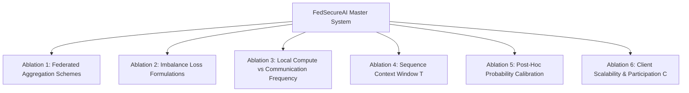

# FedSecureAI: Systematic Ablation Study Plan

## 1. Overview & Research Objectives

The purpose of this ablation plan is to isolate and quantify the marginal contributions of algorithmic components, hyperparameter choices, and modeling decisions within the FedSecureAI system.

Each ablation experiment isolates a single variable while holding all other data splits, seeds, models, and optimization parameters strictly invariant.

---

## 2. Master Ablation Dimensions

---

## 3. Detailed Ablation Protocols

### 3.1 Ablation Study 1: Aggregation Algorithms Under Severe Non-IID Drift

#### Research Question:
Does adaptive parameter-drift attenuation (`FedAdaptive`) maintain convergence stability and out-perform `FedAvg` and `FedProx` when client data distributions exhibit severe typology skew?

#### Experimental Configurations:
1. **FedAvg (Baseline):** Standard sample-weighted aggregation:
   $$w^{(t+1)} = \sum_{k=1}^K \frac{n_k}{N} w_k^{(t)}$$
2. **FedProx:** Grid over proximal regularizer $\mu$:
   $$\mu \in \left\{ 10^{-5}, 10^{-4}, 10^{-3}, 10^{-2} \right\}$$
3. **FedAdaptive:** Grid over drift temperature parameter $\beta$:
   $$\beta \in \left\{ 0.1, 0.5, 1.0, 2.0 \right\}$$
   $$s_k^{(t)} = \left(\frac{n_k}{N}\right) \exp\left(-\beta \frac{\|w_k^{(t)} - w^{(t)}\|_2}{\bar{d}^{(t)} + \epsilon}\right)$$

#### Invariants:
- Dataset: IBM AML `HI-Small` (Typology Non-IID split across 3 clients).
- Architecture: 1-layer LSTM ($H=64$), learning rate $\eta = 10^{-3}$, Adam optimizer.
- Communication rounds: $R = 10$, local epochs $E = 3$, batch size $B = 64$.
- Random seed: $42$.

#### Metrics Tracked:
- Validation & Test PR-AUC, ROC-AUC, F1 score.
- Inter-client parameter distance $\|w_i^{(t)} - w_j^{(t)}\|_2$ and client variance across rounds.
- Effective aggregation weight evolution $p_k^{(t)}$ over rounds $t=1, \dots, 10$.

---

### 3.2 Ablation Study 2: Loss Function Formulations for Extreme Class Imbalance

#### Research Question:
How do gradient-modulating loss functions compare against standard cross-entropy and fixed cost-weighting in discovering rare multi-hop laundering chains?

#### Experimental Configurations:
1. **Standard BCE:**
   $$\ell_{\text{BCE}}(p, y) = - [y \log p + (1 - y) \log(1 - p)]$$
2. **Class-Weighted BCE:**
   Pos-weight scaling $w_{\text{pos}} \in \{50, 100, 250, 500, 714\}$.
3. **Binary Focal Loss with Logits:**
   Focusing parameter $\gamma \in \{0.5, 1.0, 2.0, 3.0\}$ with balance factor $\alpha = 0.25$.

#### Invariants:
- Aggregation: FedAvg, Non-IID partition, LSTM ($H=64$), $R=10, E=3$.

#### Metrics Tracked:
- PR-AUC and ROC-AUC.
- Recall at low operational False Positive Rates: Recall@FPR=0.1% and Recall@FPR=1.0%.
- Training gradient magnitude distribution across positive vs negative examples.

---

### 3.3 Ablation Study 3: Local Compute vs Communication Frequency ($E$ Local Epochs)

#### Research Question:
What is the optimal balance between client communication rounds and local epoch count before client drift causes catastrophic forgetting?

#### Experimental Configurations:
- Local Epochs: $E \in \{1, 3, 5, 10\}$.
- Total Local Optimization Steps: Evaluated under fixed total computation budget ($R \times E = 30$).
  1. $R=30, E=1$ (High communication, minimal local drift).
  2. $R=10, E=3$ (Standard FedSecureAI benchmark).
  3. $R=6, E=5$ (Moderate communication).
  4. $R=3, E=10$ (Low communication, severe local overfitting risk).

#### Metrics Tracked:
- Total uplink/downlink communication payload (MB).
- Final test PR-AUC and convergence rate.
- Disagreement metric $\Delta_{\text{drift}} = \frac{1}{\binom{K}{2}} \sum_{i < j} \|w_i - w_j\|_2$.

---

### 3.4 Ablation Study 4: Transaction Context Window Length ($T_{\max}$)

#### Research Question:
How far back must an account's transaction history be preserved to reliably identify structuring and layering patterns?

#### Experimental Configurations:
- Truncation Window: $T_{\max} \in \{3, 5, 10, 15, 20\}$ past transactions.
- Zero-padding and packing behavior verified across all sequence lengths.

#### Metrics Tracked:
- GPU memory allocation during training.
- PR-AUC, F1 score, and inference latency per 1,000 sequences.
- Integrated Gradients attribution decay over historical time steps ($t-1, t-2, \dots, t-T$).

---

### 3.5 Ablation Study 5: Post-Hoc Probability Calibration

#### Research Question:
Which calibration method provides the most reliable confidence scores for human AML compliance analysts without distorting true positive ordering?

#### Experimental Configurations:
1. **Raw Uncalibrated Sigmoid Probabilities**
2. **Temperature Scaling (Parametric, Logit-level):** $\hat{p} = \sigma(z / T)$
3. **Platt Scaling (Logistic regression on logits):** $\hat{p} = \sigma(a z + b)$
4. **Isotonic Regression (Non-parametric piece-wise isotonic fit)**

#### Invariants:
- Calibration models fitted strictly on the validation partition $\mathcal{D}_{\text{val}}$.
- Evaluation evaluated out-of-sample on the test partition $\mathcal{D}_{\text{test}}$.

#### Metrics Tracked:
- Expected Calibration Error (ECE) across 10 and 15 bins.
- Maximum Calibration Error (MCE).
- Brier Score: $\frac{1}{N} \sum_{i=1}^N (p_i - y_i)^2$.
- Invariance check: PR-AUC and ROC-AUC delta before and after calibration.

---

### 3.6 Ablation Study 6: Client Scalability & Partial Client Participation

#### Research Question:
How resilient is the federated aggregation protocol to partial client availability and federations scaled to more institutions?

#### Experimental Configurations:
- Total Clients: $K \in \{3, 5, 10\}$ synthetic institutional splits.
- Participation Fraction: $C \in \{0.33, 0.67, 1.00\}$.
- Straggler / Dropout Simulation: 1 client randomly dropped per round with probability $p_{\text{drop}} \in \{0.0, 0.2, 0.4\}$.

#### Metrics Tracked:
- Global model convergence stability.
- Robustness to missing client gradient updates.

