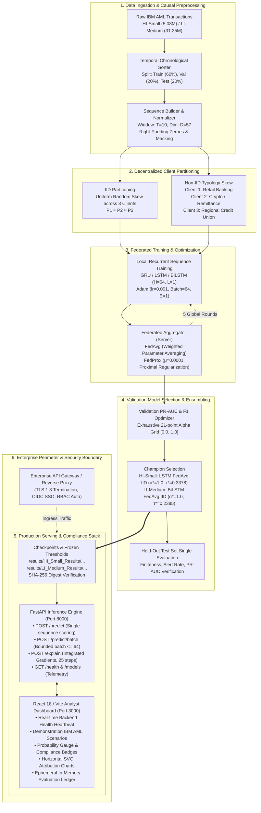

# FedSecureAI: End-to-End System & Software Architecture

**Document ID:** `results/phase16/fedsecureai_architecture.md`  
**Phase:** 16 — Final Project Documentation & Demonstration Package  
**Date:** 2026-10-27  
**Project:** FedSecureAI — Privacy-Preserving, Explainable, Drift-Aware Federated AML  
**Status:** COMPLETE & VERIFIED  

---

## 1. Architectural Overview & System Boundary

FedSecureAI integrates decentralized, privacy-preserving federated machine learning with operational financial crime compliance tooling. The architecture is strictly segregated into two distinct domains:

1. **The Research & Experimentation Pipeline:** Offline distributed simulation that reads raw chronological IBM AML transaction data, constructs causal temporal sequences, partitions data into IID and Non-IID client silos, executes federated rounds (FedAvg and FedProx), performs validation-based model selection, tunes ensembling ($\alpha$), evaluates calibration (ECE), and extracts local feature attributions via Integrated Gradients.
2. **The Production-Serving Microservice Stack:** An online inference engine and compliance dashboard. The Phase 13 FastAPI backend preloads verified champion checkpoints, validates input tensors ($T \le 10, D=57$), applies immutable decision thresholds ($\tau_{\text{HI}} = 0.337784, \tau_{\text{LI}} = 0.238483$), and computes on-demand Integrated Gradients feature attributions. The Phase 14B React analyst dashboard provides a zero-PII, memory-only session triage interface for compliance investigators.

---

## 2. End-to-End System Architecture Diagram

---

## 3. Component Breakdown & Data Flow

### 3.1 Data Ingestion & Preprocessing Tier
- **Input:** Chronological raw transaction CSVs (`transactions.csv`).
- **Feature Extraction:**
  - Categoricals: `payment_format`, `currency` transformed to nominal ordinal codes via metadata transformers.
  - Continuous: `amount`, inter-arrival `seconds_since_prior`, outbound `sender_prior_amount_log`, `sender_prior_count_log`, and inbound `receiver_seconds_since_prior_log` normalized via natural logarithm.
- **Output:** Tensor shape $(B, 10, 57)$ where $B$ is batch size, 10 is the sequence temporal window, and 57 is the expanded feature vector dimension. Valid sequences shorter than 10 are right-padded with zero floats: $X_{t, d} = 0.0$ for $t \ge L$.

### 3.2 Federated Coordination Tier
- **Federated Orchestrator:** Implemented in `backend/infrastructure/federated/`.
- **Aggregation Protocols:**
  - `FedAvg`: Standard parameter averaging weighted by client transaction volume: $\sum \frac{N_k}{N} w_k$.
  - `FedProx`: Adds local proximal loss term $\frac{\mu}{2}\|w - w^t\|^2$ where $\mu = 0.0001$.
- **Communication Volume:** 5 communication rounds, 1 local epoch per round, full model exchange per client.

### 3.3 Model Selection & Ensembling Tier
- **Validation Isolation:** All hyperparameter tuning, model checkpoint selection, threshold calibration ($\tau^*$), and hybrid blending coefficients ($\alpha^*$) are derived strictly on the 20% validation split.
- **Frozen Specifications:**
  - `HI-Small`: Checkpoint `hi_small_lstm_fedavg_iid_seed42_global_best.pt`, $\tau^* = 0.3377837836742401$, $\alpha^* = 1.00$.
  - `LI-Medium`: Checkpoint `config_5/global_best.pt`, $\tau^* = 0.2384829968214035$, $\alpha^* = 1.00$.

### 3.4 Production Serving Engine (`backend/interfaces/api`)
- **FastAPI / ASGI Framework:** Uvicorn single-worker asynchronous HTTP server binding to `127.0.0.1:8000`.
- **Integrity Middleware:** `RequestTimingAndPrivacyMiddleware` records latency headers (`X-Response-Time-Ms`) and strips internal stack traces from error payloads.
- **Pydantic v2 Schemas:** Strict input validation enforcing $T=10, D=57$, finite float ranges, and zero-padding rules.
- **Integrated Gradients Engine:** Native PyTorch autodiff implementation computing 25 Riemann interpolation steps over a zero baseline with gradient masking.

### 3.5 Compliance Analyst Dashboard (`frontend/`)
- **Single Page Application:** React 18, Vite 6, TypeScript 5.6.
- **Component Hierarchy:**
  - `App.tsx`: Navigation router and layout wrapper.
  - `Header.tsx`: Continuous polling heartbeat querying `GET /health`.
  - `DashboardOverview.tsx`: Inventory of loaded recurrent models and operational constraints.
  - `PredictionPage.tsx`: Scenario testing, probability meter, threshold callout, and Integrated Gradients bar charts.
  - `AttributionBarChart.tsx`: High-performance SVG horizontal chart categorizing drivers into semantic groups.
  - `PredictionHistoryTable.tsx`: Volatile in-memory audit ledger.
- **Data Governance:** Ephemeral memory-only state (`useState`). Zero usage of `localStorage`, `sessionStorage`, `IndexedDB`, or cookies.

---

## 4. Distinction: Research Experiments vs. Production Serving

| Dimension | Research & Experimentation Pipeline | Production Serving Microservice Stack |
| :--- | :--- | :--- |
| **Execution Environment** | Offline / High-Performance Colab & Server Clusters | Local containerized microservice (`127.0.0.1`) |
| **Data Scope** | Full 31.25M-row training, validation, and test splits | Real-time single sequence or bounded batch ($\le 64$) |
| **Model Scope** | 24 model combinations (GRU, LSTM, BiLSTM $\times$ FedAvg, FedProx $\times$ IID, Non-IID) | 2 Champion Models (`HI-Small LSTM` & `LI-Medium BiLSTM`) |
| **Explainability Scope** | Full-scale attribution sweeps across 200 validation sequences | On-demand 25-step local attribution on active alert sequences |
| **Threshold Logic** | Exhaustive search over 1,000 threshold candidates | Immutable frozen threshold evaluation ($\tau_{\text{HI}}, \tau_{\text{LI}}$) |
| **State Persistence** | Saves NPZ predictions, CSV metrics, and matplotlib plots to `results/` | Ephemeral in-memory execution; zero disk logging of customer payloads |

