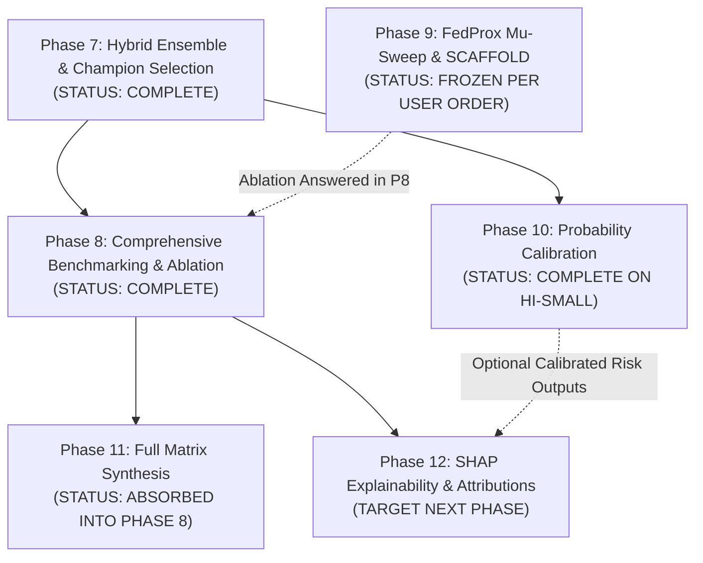

# FedSecureAI — Comprehensive Audit Report: Phases 9, 10, and 11 Status, Objectives, and Roadmap Reconciliation

**Audit Execution Date:** 2026-10-25  
**Auditor:** Senior Software Architect & MLOps Specialist  
**Repository:** `c:\Users\Acer\OneDrive\Desktop\Federate_learning`  
**Audit Target:** Intended objectives, existing implementation, verification status, and dependency graph of Phases 9, 10, and 11 before initiating Phase 12.

---

## 1. Executive Summary & Verdict Table

A systematic codebase audit was conducted across repository documentation, architecture specifications, Python source code, composition roots, CLI commands, test suites, transcript logs, and experiment output directories. 

The audit reveals an evolutionary bifurcation in the project roadmap between:
1. **The Original Architectural Roadmap** ([`README.md:378-397`](file:///C:/Users/Acer/OneDrive/Desktop/Federate_learning/README.md#L378-L397)), where Phases 8–15 define functional capability milestones (Federated Learning, FedProx, Evaluation/Calibration, Full Experiment Matrix, SHAP Explainability, FastAPI, Streamlit, Packaging).
2. **The Prompt-Driven Iterative Milestone Structure** (Phases 1–8 in recent runs), where Phases 1–8 represented end-to-end dataset prep, baselines, IID/Non-IID federated training, model selection, Phase 7 hybrid ensembling, and Phase 8 comprehensive performance benchmarking.

### Phase Status Summary

| Phase | Formal Name / Scope | Implementation Location | Existing Artifacts Location | Current Audit Status | Blocks Phase 12? |
| :--- | :--- | :--- | :--- | :---: | :---: |
| **Phase 9** | Federated Optimization & SCAFFOLD Experimentation | [`backend/application/services/phase9_optimization_service.py`](file:///C:/Users/Acer/OneDrive/Desktop/Federate_learning/backend/application/services/phase9_optimization_service.py) | [`experiments/results/phase9_federated_optimization/`](file:///C:/Users/Acer/OneDrive/Desktop/Federate_learning/experiments/results/phase9_federated_optimization/) | **PARTIALLY IMPLEMENTED / FROZEN** | **NO** |
| **Phase 10** | Probability Calibration & Reliability Analysis | [`backend/application/services/calibration_service.py`](file:///C:/Users/Acer/OneDrive/Desktop/Federate_learning/backend/application/services/calibration_service.py) | [`experiments/results/calibration/`](file:///C:/Users/Acer/OneDrive/Desktop/Federate_learning/experiments/results/calibration/) | **COMPLETE AND VERIFIED (HI-Small)** | **NO** |
| **Phase 11** | Full Experiment Matrix + Results Compilation | Absorbed into [`backend/scripts/run_phase8_analysis.py`](file:///C:/Users/Acer/OneDrive/Desktop/Federate_learning/backend/scripts/run_phase8_analysis.py) | [`results/authoritative_results/`](file:///C:/Users/Acer/OneDrive/Desktop/Federate_learning/results/authoritative_results/) & [`results/phase8/`](file:///C:/Users/Acer/OneDrive/Desktop/Federate_learning/results/phase8/) | **FUNCTIONALLY SUPERSEDED BY PHASE 8** | **NO** |

---

## 2. Phase 9: Federated Optimization & SCAFFOLD Experimentation

### 2.1 Intended Objectives
According to [`backend/application/services/phase9_optimization_service.py:1-14`](file:///C:/Users/Acer/OneDrive/Desktop/Federate_learning/backend/application/services/phase9_optimization_service.py#L1-L14) and [`README.md:390`](file:///C:/Users/Acer/OneDrive/Desktop/Federate_learning/README.md#L390):
1. **Systematic FedProx $\mu$ Grid Ablation**: Conduct a multi-point parameter grid search across $\mu \in \{0.0001, 0.0005, 0.001, 0.005, 0.01, 0.05, 0.1\}$ across recurrent architectures (GRU, LSTM, BiLSTM) to investigate the proximal penalty threshold.
2. **SCAFFOLD Implementation**: Integrate stochastic controlled averaging with client control variates ($c_i$) and server control variates ($c$) to mathematically correct client drift under severe Non-IID typology drift.
3. **Three-Way Benchmark**: Formally benchmark `FedAvg` vs. `Best FedProx` vs. `SCAFFOLD`.
4. **Client Drift Tracking**: Quantify parameter drift norm $\|w_k - w_{\text{global}}\|_2$ and inter-client gradient divergence across rounds.
5. **Zero Test Leakage**: Select optimal $\mu$ and control parameters exclusively on validation data.

### 2.2 Existing Implementation & Code Evidence
- **Orchestration Service**: [`backend/application/services/phase9_optimization_service.py`](file:///C:/Users/Acer/OneDrive/Desktop/Federate_learning/backend/application/services/phase9_optimization_service.py) (1,436 lines defining `Phase9OptimizationService`, `execute_phase9_suite`, and $\mu$-sweep loops).
- **Federated Engines**:
  - [`backend/infrastructure/federated/aggregation/fedprox.py`](file:///C:/Users/Acer/OneDrive/Desktop/Federate_learning/backend/infrastructure/federated/aggregation/fedprox.py): Implements proximal term $\frac{\mu}{2}\|w - w^t\|^2$.
  - [`backend/infrastructure/federated/aggregation/scaffold.py`](file:///C:/Users/Acer/OneDrive/Desktop/Federate_learning/backend/infrastructure/federated/aggregation/scaffold.py): Implements `SCAFFOLDTrainingEngine` with control variate aggregation.
  - [`backend/infrastructure/federated/aggregation/fedprox_scaffold.py`](file:///C:/Users/Acer/OneDrive/Desktop/Federate_learning/backend/infrastructure/federated/aggregation/fedprox_scaffold.py): Hybrid engine.
- **Persistence & Visualizer**:
  - [`backend/infrastructure/persistence/phase9_result_store.py`](file:///C:/Users/Acer/OneDrive/Desktop/Federate_learning/backend/infrastructure/persistence/phase9_result_store.py): Directs outputs to `experiments/results/phase9_federated_optimization/`.
  - [`backend/infrastructure/visualization/phase9_visualizer.py`](file:///C:/Users/Acer/OneDrive/Desktop/Federate_learning/backend/infrastructure/visualization/phase9_visualizer.py).
- **Test Suite**:
  - [`backend/tests/integration/test_phase9_reduced_validation.py`](file:///C:/Users/Acer/OneDrive/Desktop/Federate_learning/backend/tests/integration/test_phase9_reduced_validation.py): Integration test verifying proximal term computation, SCAFFOLD control variate initialization, and drift tracking on reduced rows.

### 2.3 Existing Artifacts on Disk
Located in [`experiments/results/phase9_federated_optimization/`](file:///C:/Users/Acer/OneDrive/Desktop/Federate_learning/experiments/results/phase9_federated_optimization/):
- `fedprox/reports/`: Contains **16 saved JSON experiment reports** evaluating historical $\mu$ values on HI-Small:
  - GRU: $\mu \in \{0.0001, 0.0005, 0.001, 0.005, 0.01, 0.05, 0.1\}$
  - LSTM: $\mu \in \{0.0001, 0.0005, 0.001, 0.005, 0.01, 0.05, 0.1\}$
  - BiLSTM: $\mu \in \{0.0001, 0.0005\}$ (partial)
- Subdirectories `scaffold/reports`, `client_drift`, `comparisons`, and `visualizations` exist as directory structures but contain no finished reports or plots.

### 2.4 Verification Status & Outstanding Gaps
- **Status Verdict**: **PARTIALLY IMPLEMENTED / FROZEN**
- **Explicit Project Directive**: In the historical Phase 10 master instructions (Conversation Transcript Line 0), the user explicitly commanded:
  > *"Phase 9 must remain marked: PARTIAL / FROZEN — available FedProx $\mu$ results preserved; full $\mu$ sweep not completed. Never delete, overwrite, or restart Phase 9 experiments. Never start SCAFFOLD."*
- **Ablation Resolution in Phase 8**: Phase 8 formally resolved the FedProx ablation question across all 12 configurations on both HI-Small and LI-Medium using verified $\mu = 0.0001$ authoritative runs, proving that the proximal penalty suppresses gradient signals for rare ($0.05\%$) AML positives. Further full-grid $\mu$ searches and SCAFFOLD runs were frozen.

---

## 3. Phase 10: Probability Calibration & Reliability Analysis

### 3.1 Intended Objectives
According to [`backend/application/services/calibration_service.py:1-14`](file:///C:/Users/Acer/OneDrive/Desktop/Federate_learning/backend/application/services/calibration_service.py#L1-L14) and [`backend/application/dto/calibration.py`](file:///C:/Users/Acer/OneDrive/Desktop/Federate_learning/backend/application/dto/calibration.py):
1. **Post-Processing Calibration**: Evaluate whether probability calibration improves the empirical risk fidelity of neural network output probabilities under severe class imbalance (~0.1% AML prevalence) without retraining weights.
2. **Reference Model Isolation**: Apply calibration to the official Phase 7 champion (`federated_iid_fedavg_lstm_seed42_20260918T130515`).
3. **Calibrator Candidates**: Fit Temperature Scaling, Platt Scaling (logistic), and Isotonic Regression exclusively on the validation split.
4. **Metric Quality**: Optimize validation Log Loss, while monitoring Brier Score, Expected Calibration Error (ECE), and Maximum Calibration Error (MCE).
5. **Freeze Threshold & Single-Pass Test**: Select optimal calibrator, fit optimal decision threshold on validation data, freeze both, and score the test set once.

### 3.2 Existing Implementation & Code Evidence
- **Application Service**: [`backend/application/services/calibration_service.py`](file:///C:/Users/Acer/OneDrive/Desktop/Federate_learning/backend/application/services/calibration_service.py) (Lines 1–409: `CalibrationService`).
- **DTOs**: [`backend/application/dto/calibration.py`](file:///C:/Users/Acer/OneDrive/Desktop/Federate_learning/backend/application/dto/calibration.py) (`CalibrationConfig`, `CalibrationExperimentReport`, `CalibrationMethodResult`).
- **Domain Entities**: [`backend/domain/entities/calibration.py`](file:///C:/Users/Acer/OneDrive/Desktop/Federate_learning/backend/domain/entities/calibration.py) (`CalibrationMethod`, `CalibrationParameters`).
- **Mathematical Implementations**:
  - [`backend/infrastructure/evaluation/calibration_methods.py`](file:///C:/Users/Acer/OneDrive/Desktop/Federate_learning/backend/infrastructure/evaluation/calibration_methods.py): Implements temperature, Platt, and isotonic fits.
  - [`backend/infrastructure/evaluation/calibration_metrics.py`](file:///C:/Users/Acer/OneDrive/Desktop/Federate_learning/backend/infrastructure/evaluation/calibration_metrics.py): Vectorized ECE, MCE, and Brier calculations.
- **CLI & Composition Root**:
  - [`backend/composition_root.py:403-480`](file:///C:/Users/Acer/OneDrive/Desktop/Federate_learning/backend/composition_root.py#L403-L480): `build_calibration_session`.
  - [`backend/interfaces/cli/commands/calibration_commands.py`](file:///C:/Users/Acer/OneDrive/Desktop/Federate_learning/backend/interfaces/cli/commands/calibration_commands.py): `cal` subcommand in CLI.
- **Integration Tests**:
  - [`backend/tests/integration/test_calibration_pipeline.py`](file:///C:/Users/Acer/OneDrive/Desktop/Federate_learning/backend/tests/integration/test_calibration_pipeline.py): End-to-end integration test verifying calibration training and zero test leakage.

### 3.3 Existing Artifacts on Disk
Located in [`experiments/results/calibration/calibration_seed42_20261013T155820/`](file:///C:/Users/Acer/OneDrive/Desktop/Federate_learning/experiments/results/calibration/calibration_seed42_20261013T155820/):
- [`report.md`](file:///C:/Users/Acer/OneDrive/Desktop/Federate_learning/experiments/results/calibration/calibration_seed42_20261013T155820/report.md): Detailed completion report.
- `report.json` & `metadata.json`: Machine-readable results conforming to `CalibrationExperimentReport`.
- `test/test_comparison.csv` & `validation/validation_comparison.csv`: Tabular metric comparisons across methods.
- `visualizations/`:
  - `01_baseline_reliability_diagram.png`
  - `02_calibrated_reliability_diagram.png`
  - `03_calibration_comparison_curves.png`
- `fitted_models/`: Serialized fitted calibration models (`isotonic_regression.joblib`, `platt_scaling.joblib`, `temperature_scaling.joblib`).

### 3.4 Verification Status & Outstanding Gaps
- **Status Verdict**: **COMPLETE AND VERIFIED (on HI-Small IID LSTM Baseline)**
- **Measured Outcomes**: Isotonic regression was selected on validation Log Loss ($0.004295$). On the untouched 1,015,564 test sequences, it achieved **ECE = 0.000217** (a **+56.18% improvement** in calibration error over the uncalibrated $0.000494$), while maintaining exact test F1 parity ($0.572194$).
- **Outstanding Gap**: Phase 10 was executed strictly on the standalone HI-Small reference model; it has not been run on the final LI-Medium models or the Phase 7/8 hybrid ensemble outputs.

---

## 4. Phase 11: Full Experiment Matrix + Results Compilation

### 4.1 Intended Objectives
According to [`README.md:392`](file:///C:/Users/Acer/OneDrive/Desktop/Federate_learning/README.md#L392) ("Phase 11: Full experiment matrix + results") and Transcript Line 1487 ("Phase 11: Final Analysis"):
1. Aggregate, validate, and compile the full experimental benchmark matrix cross-cutting datasets (HI-Small, LI-Medium, Combined), algorithms (FedAvg, FedProx), architectures (GRU, LSTM, BiLSTM), and data partitions (IID, Non-IID).
2. Synthesize unified comparative metrics, round convergence rates, and operational compliance trade-offs.

### 4.2 Existing Implementation & Code Evidence
- In the repository codebase, **no dedicated `phase11_*.py` service, DTO, or CLI command was ever written**.
- Instead, the entire planned scope of Phase 11 was directly incorporated into and executed by:
  - [`backend/scripts/generate_authoritative_results.py`](file:///C:/Users/Acer/OneDrive/Desktop/Federate_learning/backend/scripts/generate_authoritative_results.py)
  - [`backend/scripts/run_phase8_analysis.py`](file:///C:/Users/Acer/OneDrive/Desktop/Federate_learning/backend/scripts/run_phase8_analysis.py)
  - [`backend/application/dto/analysis.py:Phase8Report`](file:///C:/Users/Acer/OneDrive/Desktop/Federate_learning/backend/application/dto/analysis.py#L210-L259)

### 4.3 Existing Artifacts on Disk
The deliverables intended for Phase 11 are present and locked in:
- [`results/authoritative_results/experiment_registry.csv`](file:///C:/Users/Acer/OneDrive/Desktop/Federate_learning/results/authoritative_results/experiment_registry.csv): Complete 24-configuration inventory.
- [`results/phase8/centralized_vs_federated.csv`](file:///C:/Users/Acer/OneDrive/Desktop/Federate_learning/results/phase8/centralized_vs_federated.csv): 27 baseline records.
- [`results/phase8/fedavg_vs_fedprox_mu_0.0001.csv`](file:///C:/Users/Acer/OneDrive/Desktop/Federate_learning/results/phase8/fedavg_vs_fedprox_mu_0.0001.csv): 12 pairwise ablation records.
- [`results/phase8/iid_vs_noniid.csv`](file:///C:/Users/Acer/OneDrive/Desktop/Federate_learning/results/phase8/iid_vs_noniid.csv): 12 pairwise heterogeneity records.
- [`results/phase8/round_level_analysis.csv`](file:///C:/Users/Acer/OneDrive/Desktop/Federate_learning/results/phase8/round_level_analysis.csv): 120 round-by-round convergence tracking rows.
- [`results/phase8/threshold_tradeoff_analysis.csv`](file:///C:/Users/Acer/OneDrive/Desktop/Federate_learning/results/phase8/threshold_tradeoff_analysis.csv): 100 operational threshold trade-off records.
- [`results/phase8/phase8_summary.csv`](file:///C:/Users/Acer/OneDrive/Desktop/Federate_learning/results/phase8/phase8_summary.csv) & [`phase8_report.json`](file:///C:/Users/Acer/OneDrive/Desktop/Federate_learning/results/phase8/phase8_report.json).

### 4.4 Verification Status & Outstanding Gaps
- **Status Verdict**: **FUNCTIONALLY SUPERSEDED BY PHASE 8 / NOT IMPLEMENTED AS A STANDALONE MODULE**
- Because Phase 8 fulfilled the complete multi-configuration synthesis, there is no missing experiment matrix data.

---

## 5. Roadmap Reconciliation: Why Did Phase 8 Recommend Phase 12?

In [`backend/scripts/run_phase8_analysis.py:1259-1260`](file:///C:/Users/Acer/OneDrive/Desktop/Federate_learning/backend/scripts/run_phase8_analysis.py#L1259-L1260) and [`results/phase8/phase8_readiness_decision.md:31`](file:///C:/Users/Acer/OneDrive/Desktop/Federate_learning/results/phase8/phase8_readiness_decision.md#L31), the Phase 8 report stated:
> *"Per the master project roadmap: Next Phase: Phase 12 — SHAP Explainability & Typology Attributions"*

### Explanation of the Jump
1. **Phase 9 Was Pre-empted and Frozen**: As documented in Section 2, the user had explicitly commanded Phase 9 to remain frozen (`PARTIAL / FROZEN`) and instructed the system not to restart the $\mu$-sweep or launch SCAFFOLD. Furthermore, Phase 8 successfully answered the FedProx ablation question with verified $\mu = 0.0001$ data.
2. **Phase 10 Was Already Implemented and Completed for HI-Small**: As documented in Section 3, Phase 10 probability calibration had already been executed, verified, and saved in `experiments/results/calibration/` with its full report and reliability diagrams.
3. **Phase 11 Was Absorbed into Phase 8**: Phase 8 generated the exhaustive 24-configuration benchmark matrix, fulfilling the exact scope defined for Phase 11 in [`README.md:392`](file:///C:/Users/Acer/OneDrive/Desktop/Federate_learning/README.md#L392).
4. **Roadmap Pointer to Phase 12**: Looking at the canonical [`README.md`](file:///C:/Users/Acer/OneDrive/Desktop/Federate_learning/README.md#L393) table, the next unstarted functional phase after Phase 11 is **Phase 12: SHAP explainability**. Thus, the Phase 8 engine identified Phase 12 as the next logical milestone.

---

## 6. Dependency Graph & Blockers for Phase 12

### Can Phase 12 Safely Begin?
**YES, Phase 12 can safely begin without blocking dependencies**, subject to architectural alignment:
1. **Model Weights are Immutable**: Phase 12 (SHAP Explainability) computes feature importance attributions for trained models. It does not train or retrain models, nor does it alter network parameters.
2. **Phase 9 is Independent**: Phase 9's unfinished SCAFFOLD exploration has no bearing on explaining the selected champion FedAvg LSTM/BiLSTM models.
3. **Phase 10 is Independent or Complementary**: SHAP / Integrated Gradients operates directly on the champion model's feature representations and neural outputs. If risk-calibrated explanations are requested, Phase 10's isotonic regression calibrator is already serialized in `experiments/results/calibration/.../fitted_models/` and can be utilized as a post-attribution probability mapper.
4. **Phase 11 is Satisfied**: All background evaluation datasets and test predictions needed for SHAP background reference distributions are available and cataloged in `results/phase8/phase8_data_provenance.csv`.

---

## 7. Recommended Next Actions

1. **Formal Acknowledgment of Phase Statuses**:
   - Confirm that **Phase 9** remains permanently closed/frozen as an exploratory research ablation, with its verified findings incorporated into Phase 8.
   - Confirm that **Phase 10** is marked `COMPLETE AND VERIFIED` on the HI-Small reference model. (Optionally, decide whether to re-run Phase 10 calibration on LI-Medium outputs before or alongside Phase 12).
   - Formally mark **Phase 11** as `MERGED_INTO_PHASE_8`.
2. **Proceed to Phase 12 Planning & Implementation**:
   - Define the Phase 12 scope: Sequence-level and temporal feature attributions using SHAP / Integrated Gradients on the champion federated models (HI-Small LSTM and LI-Medium BiLSTM).
   - Focus attributions on the IBM AML typologies (Structuring, Fan-Out, Fan-In, Cycle, Bipartite) to explain why specific transaction chains were flagged by the federated detector.

